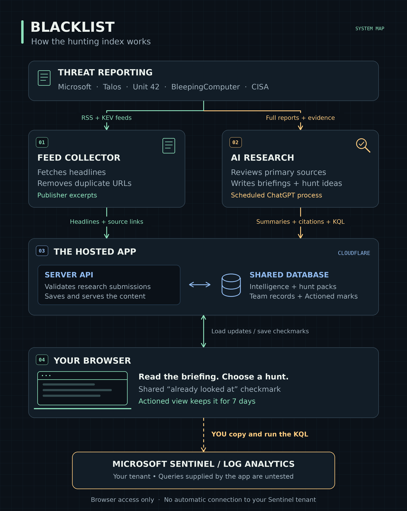

# Blacklist

A browser-based threat-intelligence and Microsoft Sentinel hunting index. This
folder contains the application source, database migrations, feed ingestion,
hunt library, tests and a handover for rebuilding it with Claude.

**Start with [the rebuild handover](docs/CLAUDE_HANDOVER.md).**



## What is here

| Location | Purpose |
|---|---|
| `app/workspace.tsx`, `app/globals.css` | Responsive SOC console and visual design. |
| `app/api/` | Workspace, refresh, research and shared Actioned endpoints. |
| `app/lib/feeds.ts` | Publisher RSS and CISA KEV ingestion. |
| `app/lib/packs.ts` | Proposed Sentinel / Log Analytics hunt packs. |
| `app/lib/seeds.ts` | Source-controlled starting briefings; not the live database. |
| `db/`, `drizzle/` | Shared records, schema and migrations. |
| `app/chatgpt-auth.ts`, `build/` | Original Sites identity and hosting integration. |
| `tests/` | Feed/intelligence contracts and Actioned behaviour tests. |
| `docs/sites-operation.md` | Original hosted-app operating notes. |

## Source snapshot

Exported on 10 October 2026 from source commit
`890c3120b2f94383a5de24d9da291f44b5a83528`. Application logic and styles are
retained. The original Site project ID and generated TypeScript cache are
excluded. Credentials, deployment state, live database records and the
external scheduled task are not included.

The product name for a rebuild is **Blacklist**. Some original source strings
still use the earlier “The Blacklist — Hunting Index” branding.

## Runtime and local development

The current implementation uses React, TypeScript, Tailwind, Vinext, Cloudflare
Workers, Drizzle and a D1 database bound as `DB`. Use Node 22.13 or later and
the pnpm version declared in `package.json`.

From this folder, on a development machine:

```sh
pnpm install --frozen-lockfile
pnpm dev
```

This is the original Sites-oriented application, not a standalone Claude
Artifact. A working rebuild also needs database migrations, authentication
and a scheduler appropriate to the selected host. The local Vite integration
contains a development auth mock; it is not production authentication.
See the handover before deploying outside Sites.

With dependencies installed, run the retained checks:

```sh
node node_modules/typescript/bin/tsc --noEmit
node tests/run-actioned.mjs
```

## Product behaviour

- Feed excerpts are labelled separately from researched briefings.
- Briefings provide summaries, source-linked facts, reading lists and proposed
  hunts with prerequisites, KQL, next steps, expected findings and limitations.
- An Actioned checkmark is a shared “already looked at” signal. It leaves the
  inbox immediately and stays in Actioned for seven days after marking.
  Expiry hides it from Actioned without returning it to the inbox or deleting
  the briefing. Undo restores inbox eligibility.
- Existing investigation records remain compatible, but investigation
  administration belongs in the team's existing board.
- There is no Sentinel tenant connection or automatic query execution. All
  KQL is untested until checked in the intended environment.

This application is kept under `apps/` separately from the repository's active
KQL modules. Embedded hunt examples are proposed app content, not a promotion
into production detections or tenant-validated hunts.
